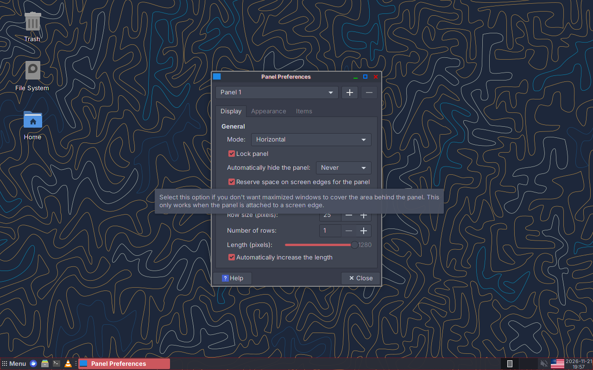

# Profil: peppermint



Izgled Peppermint OS 9 (GTK teme Peppermint-*, xfwm4 Peppermint-xfwm4, donji panel sa Whisker menijem).

```bash
curl -fsSL https://raw.githubusercontent.com/Badzolini/xfce4-theme/peppermint/peppermint.sh | bash

# iz kloniranog repoa:
./apply-profile.sh peppermint                    # Red-Dark (original)
./apply-profile.sh peppermint --color Blue-Light
./apply-profile.sh --list
```

Boje: Red, Blue, Green, Grey, Orange, Pink, Purple × Dark / Light / Mix.

Napomene:
- Ikone: original je Pepirus-Dark; ako folder `icons/Pepirus-Dark` ne postoji, koristi se Papirus-Dark.
- Peppermint 9 je koristio LXSession; ovde je sve prebačeno na standardnu xfce4-session.
- Teme potiču iz Peppermint OS 9 (Peppermint OS Team).
